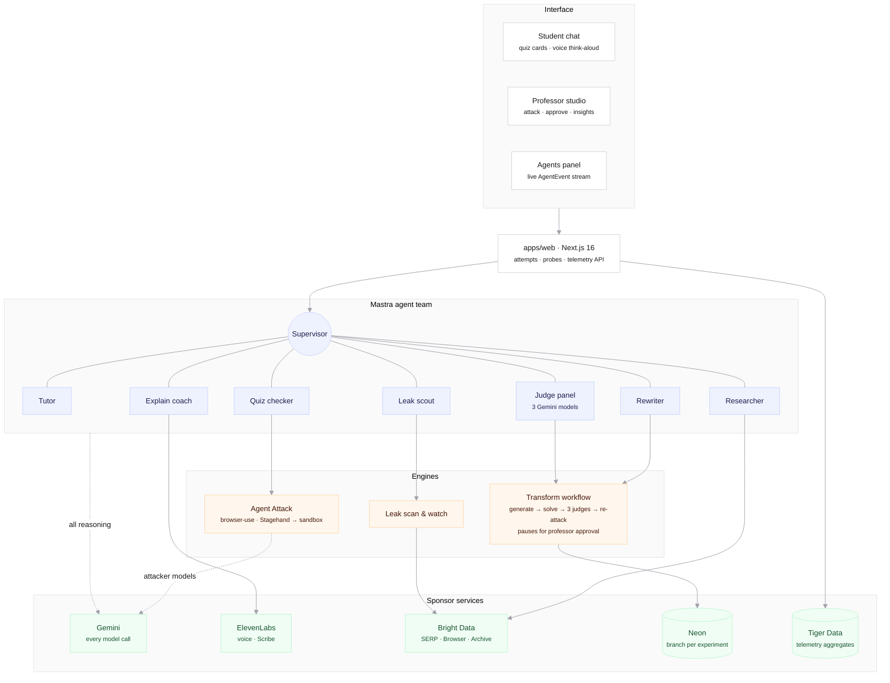
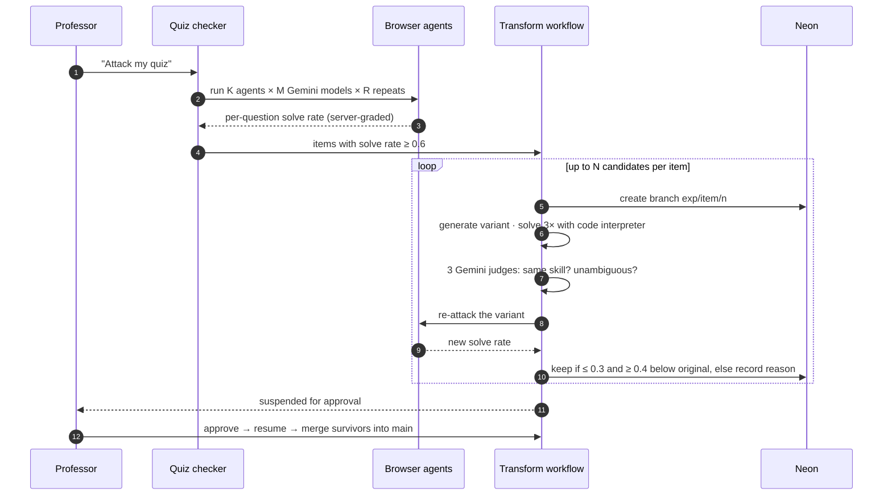
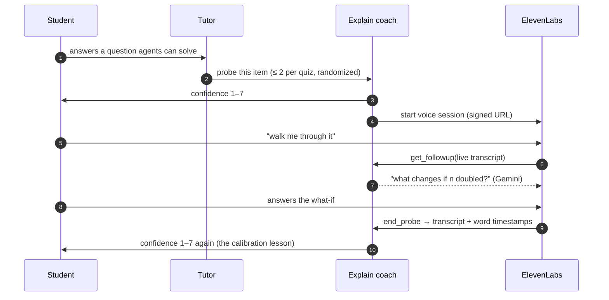

<div align="center">

# Unprompted

**Make agents fail. Make understanding visible.**

A learning app for the age of AI agents. Unprompted attacks a quiz with the same browser agents students use, rewrites the questions those agents solve into versions they fail (while still testing the same skill), and asks students to talk through their reasoning at the moments an agent would have answered for them.

`Next.js 16` · `Mastra` · `Gemini` · `ElevenLabs` · `Neon` · `Tiger Data` · `Bright Data` · `browser-use` · `Stagehand`

</div>

---

## Why

Agents can now log into a student's LMS and finish quizzes on their own, and there is no technical fix on the LMS side. Detectors that judge how text *looks* misfire on non-native writers. Unprompted takes a different approach:

| Instead of | Unprompted |
|---|---|
| Guessing whether text is AI-written | **Proves** which questions agents can solve, by running real agents against them |
| Banning tools | **Rewrites** agent-solvable questions until agents fail, keeping only versions that still test the same skill |
| Accusing students | **Asks** for a 30 to 60 second think-aloud with a "what if" follow-up, and shows the gap between *answered* and *understood* |

Every flag is evidence for a conversation, never a verdict.

## Architecture



### How a question becomes agent-resistant



### How a student is probed



## Public tools (no sign-in)

| Page | What it does |
|---|---|
| `/check` | **Is your question already online?** Paste any quiz question; Bright Data searches homework sites live and returns which sites have it, with public links. Rate-limited, at most 4 searches per check, and the pasted text is never stored (only a hash for the cache). |
| `/study` | **The State of Leaked Homework.** The 85% finding with charts by subject and site, the method and limits, and the open dataset (CSV/JSON, CC BY 4.0: links and match scores only, no copied text). |

## Sponsors: how each one is used

| Sponsor | What it does in Unprompted |
|---|---|
| **Gemini** | Every model call: browser-agent attackers, variant generation, the 3-judge panel, follow-up questions. Direct key, or GMI as a quota-free route to the same Gemini models |
| **Mastra** | An 8-agent team (Supervisor, Tutor, Explain coach, Researcher, Quiz checker, Rewriter, Judge panel, Leak scout), each with real tools, and the transform workflow with human-in-the-loop `suspend()` / `resume()` for professor approval |
| **Neon** | App data, **one copy-on-write branch per question experiment** (only survivors merge), attempt audit trail |
| **Tiger Data** | Telemetry hypertables, continuous aggregates, `state_agg` / `heartbeat_agg` features that separate agents from humans by behavior |
| **Bright Data** | Leak scan (SERP), evidence screenshots (Browser API), daily leak watch (Web Archive), cited sources for the Researcher |
| **ElevenLabs** | The voice think-aloud agent with client tools, and Scribe word timestamps for counterfactual latency |
| **Vultr** | The only deploy target (not deployed yet) |

## Results so far (real data, Nov 14 2026)

| Check | Result |
|---|---|
| Agents ace our quizzes | browser-use + Gemini: **20/20** answers on the stats quiz (95% CI 84–100%) and **42/42** on stats inference (CI 92–100%). Runs that crashed before submitting are reported separately as infrastructure, never as agent failures |
| **Leak study (Bright Data)** | **78 of 92 real textbook end-of-chapter exercises (85%) are already on homework sites** (stats 95%, calculus 100%, biology 90%, micro 95%, physics 50%). Top sites: Quizlet, Brainly, Vaia, Chegg. 8 of 8 hand-checked hits were genuine. 114 searches, about $0.17. Full method in [`docs/leak-study.md`](docs/leak-study.md) |
| Questions already online | **10/10** OpenStax exercises found on study sites; 2/5 of our own items matched (1 real, 1 likely false positive, shown with evidence) |
| Behavior beats bot flags | Automated sessions passed `webdriver` and BotD checks, but were caught by *clicks with no pointer movement* and *answers with no input events* |
| Voice probe | Tool loop verified against the live ElevenLabs agent in text mode |
| Neon branching | Create, write and merge a branch from code in 6.5 s |

## Repository

```
apps/
  web/            Next.js app: student chat, think-aloud, studio, insights, telemetry API
  sandbox/        Minimal quiz site that agents attack in isolation
services/
  workflows/      Mastra agents + transform workflow, Neon branch store, Markdown ingest
  agents/         `attack` CLI: browser-use (Python) and Stagehand (TS) runners
  leakscan/       Bright Data leak scan and evidence capture
  models/         Agent-likelihood model on Tiger features
packages/
  shared/         Types shared by every workstream (Item, AgentRun, AgentEvent, …)
  probe-core/     Follow-up question generator shared by the chat and the agents
db/
  neon/           App schema
  tiger/          Hypertables, continuous aggregates, feature views
tests/e2e/        LLM-free Playwright smoke tests of the whole app
data/quizzes/     Six original quizzes (the only content sent to models)
docs/             build-plan.md (full spec) · CONTRACTS.md (team rules)
```

## Getting started

**Requirements:** Node 25+, pnpm 10, Python 3.13 + [uv](https://docs.astral.sh/uv/), Chrome.

```bash
pnpm install
cp .env.example .env.local      # fill in the keys below; never commit this file
pnpm dev:web                    # http://localhost:3100
pnpm dev:sandbox                # http://localhost:3101 (only for agent attacks)
```

<details>
<summary><b>Environment variables</b></summary>

| Variable | Used for | Where to get it |
|---|---|---|
| `GEMINI_API_KEY` | all model calls | Google AI Studio |
| `GMI_API_KEY`, `GMI_BASE_URL` | the same Gemini models without the free-tier cap | GMI Cloud console; `https://api.gmi-serving.com/v1` |
| `ELEVENLABS_API_KEY`, `ELEVENLABS_AGENT_ID` | voice think-aloud | ElevenLabs → Developers → API Keys |
| `BRIGHTDATA_API_TOKEN`, `BRIGHTDATA_*_ZONE`, `BRIGHTDATA_CUSTOMER_ID`, `BRIGHTDATA_BROWSER_WSS` | leak scan, evidence, Researcher | Bright Data → Settings → API keys; Web Access zones |
| `NEON_API_KEY`, `NEON_PROJECT_ID`, `DATABASE_URL` | app data, branch per experiment | Neon console (project-scoped key) |
| `TIGER_DATABASE_URL` | telemetry | `tiger service create` → `tiger db uri <id> --with-password` |
| `VULTR_API_KEY` | deployment | Vultr → Account → API |
| `CANVAS_BASE_URL`, `CANVAS_TOKEN` | optional Canvas import | a Canvas teacher account |

Quote values that contain `&` (database URLs).

</details>

<details>
<summary><b>Databases</b></summary>

```bash
psql "$DATABASE_URL"       -f db/neon/schema.sql
psql "$TIGER_DATABASE_URL" -f db/tiger/schema.sql
psql "$TIGER_DATABASE_URL" -f db/tiger/aggregates.sql
# no psql? uv run --with "psycopg[binary]" python db/tiger/scripts/sql.py <file>
```

</details>

<details>
<summary><b>Commands</b></summary>

| Task | Command |
|---|---|
| Attack a quiz | `cd services/agents && uv run attack --quiz ../../data/quizzes/sample-stats.md --agents browser-use,stagehand` (add `--target runtime` for the real app) |
| Import a quiz | `pnpm --filter @unprompted/workflows ingest data/quizzes/<id>.md --quiz-id <id>` |
| Transform agent-solvable items | `pnpm --filter @unprompted/workflows transform` (`LLM_CACHE=replay` spends nothing) |
| Leak scan | `pnpm --filter @unprompted/leakscan scan` |
| Neon branch check | `pnpm --filter @unprompted/workflows killtest:neon` |

</details>

<details>
<summary><b>Tests</b></summary>

```bash
pnpm test:e2e                                   # whole app, no model calls (needs pnpm dev:web)
pnpm --filter @unprompted/web typecheck
pnpm --filter @unprompted/workflows test
pnpm --filter @unprompted/leakscan test
pnpm --filter @unprompted/sandbox test
cd services/agents && uv run pytest
```

</details>

## Principles

- **Measure understanding; never accuse.** Flags read "suggest a follow-up chat", never "cheater".
- **Prove resistance, don't assert it.** Every rewritten question carries a measured agent solve rate.
- **Grade content, not delivery.** No fluency or accent judgments; multilingual probes.
- **Honest numbers.** Bad results are reported; infrastructure failures are never counted as agent failures.
- **Only our own content goes to models.** OpenStax text (CC BY-NC-SA, no generative-AI use) is used only as leak-scan search strings, with attribution.
- **Respect the web.** Public pages only; we store snippets, links and screenshots, never solutions, and we never solve or bypass CAPTCHAs.
- **Agents attack only our own sandboxes**, never real courses or accounts.

<sub>Built at SanD Hacks 2026. Full spec: [`docs/build-plan.md`](docs/build-plan.md) · Team rules: [`docs/CONTRACTS.md`](docs/CONTRACTS.md)</sub>
