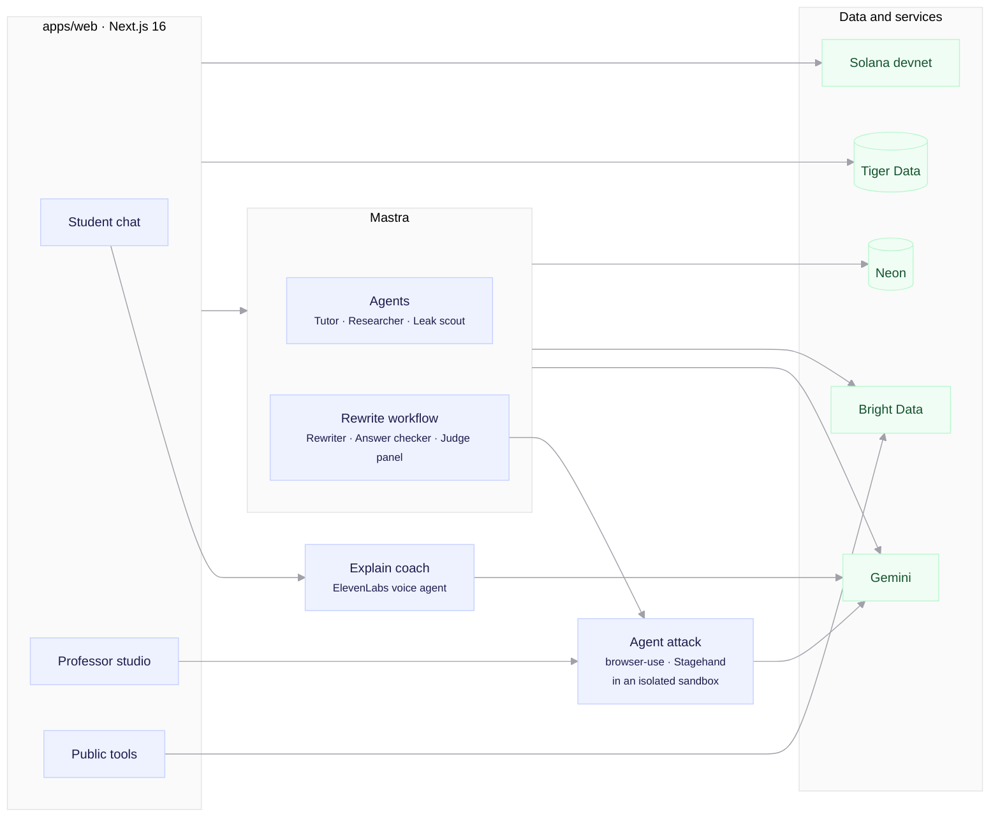
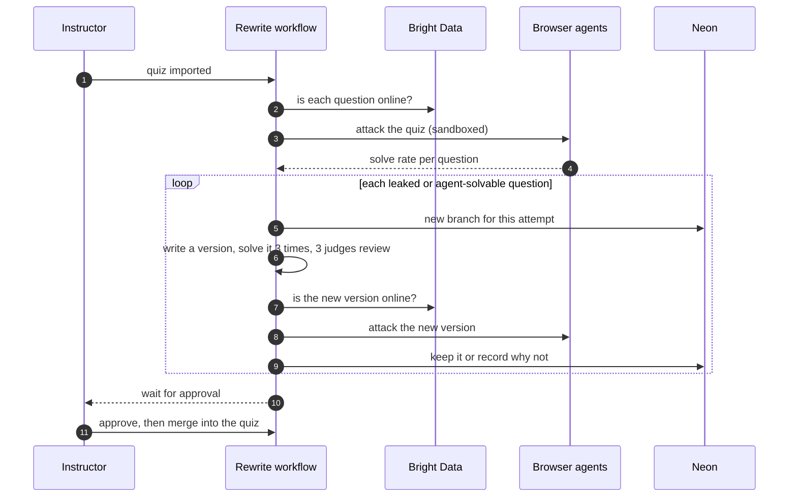
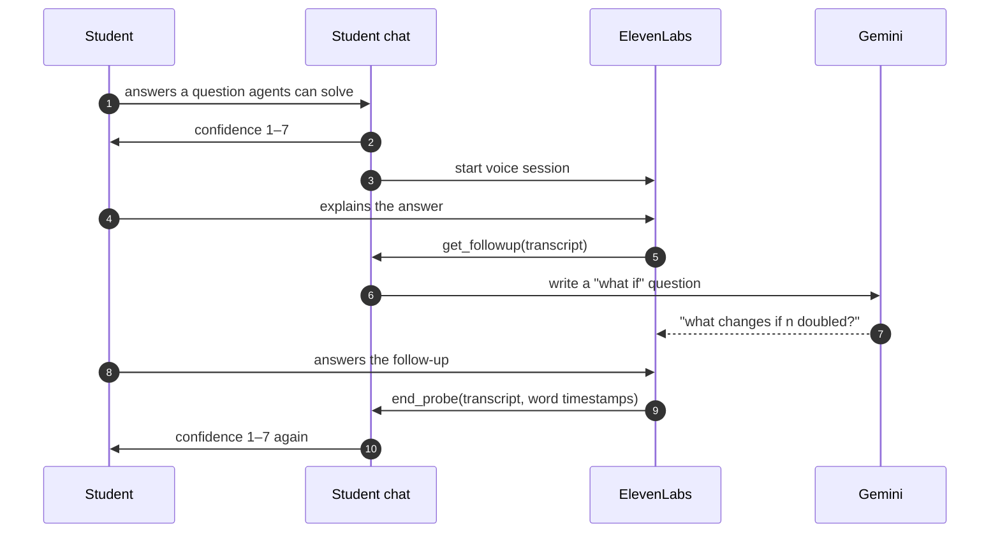

<div align="center">

# Unprompted

**Quizzes that still measure learning when AI agents can take them.**

[Live demo](https://unprompted.courses) · [Check a question](https://unprompted.courses/check) · [Leak study](https://unprompted.courses/study)

</div>

---

## What it is

AI browser agents can now log into a course site and finish a quiz on their own. Many quiz questions are also already posted, with answers, on homework sites. A score no longer shows whether a student understood the material.

Unprompted is a quiz app for instructors and students that deals with this honestly. It does not try to detect AI-written text or catch cheaters. It does three things:

1. **Measures.** Runs real AI agents against your quiz and searches homework sites, so you see which questions an agent can answer and which are already online.
2. **Rewrites.** For leaked questions, writes new versions that test the same skill and have the same answer, so a copied answer key stops working.
3. **Asks.** On a question an agent could have answered, the student explains their reasoning out loud for 30 to 60 seconds and answers one "what if" follow-up. Instructors see the gap between *answered* and *understood*.

Every flag is a reason for a conversation, never a verdict.

## Why not just write harder questions?

We tried. We wrote 10 versions of one statistics question using four strategies (new numbers, a real-world setting, find-the-error, table lookup). Gemini browser agents solved every version we could measure. You can't write a question an agent can't answer, so Unprompted checks understanding in the one place an agent can't stand in: the student's own explanation.

## What we found

| Finding | Result |
|---|---|
| Agents solve our quizzes | **175 of 175** answers correct across six quizzes (95% CI 98–100%) |
| Textbook questions are already online | **36–48%** of 500 random exercises from 10 open textbooks |
| Rewriting doesn't stop agents | **Every** measured rewrite was still solved (6/6 and 8/8) |

Agent runs were sandboxed and server-graded. Runs that crashed are reported separately, never counted as agent failures. Method, limits and the open dataset: [`docs/leak-study.md`](docs/leak-study.md).

<details>
<summary><b>Full results</b></summary>

| Check | Result |
|---|---|
| Agents by quiz | Stats 25/25, stats inference 36/36, calculus 36/36, Python 30/30, biology 24/24, microeconomics 24/24 (browser-use + Gemini; 14 crashed runs excluded) |
| Leak index | 36% (CI 32–40) show the question itself on a homework site; 48% (CI 44–53) have an exact 8–12 word phrase quoted. Highest: American Government (70–82%), then Biology and Microeconomics. Lowest: Calculus |
| Leak pilot | 84% (77/92), but on hand-picked distinctive questions, so the index above is the honest number |
| Our own quiz | 2 of the 5 stats items matched homework-site results |
| Bot detection | Agent sessions passed `webdriver` and BotD checks, but were caught by clicks with no pointer movement and answers with no input events |

All data from Nov 15, 2026.

</details>

## Try it

| Page | Who | What it does |
|---|---|---|
| [`/check`](https://unprompted.courses/check) | Anyone | Paste a quiz question and see which homework sites already have it |
| [`/study`](https://unprompted.courses/study) | Anyone | The leak study, with charts and the open dataset (CC BY 4.0) |
| [`/qr`](https://unprompted.courses/qr) | Anyone | Printable QR code to `/check` |
| Student app | Demo sign-in | Take a quiz in a chat, with voice think-aloud |
| Professor studio | Demo sign-in | Import, attack, rewrite, approve and export quizzes |

Everything except the public pages is behind a team password.

## How it works

### For instructors

| Step | What happens |
|---|---|
| Import | From Canvas (QTI export), a public course website you own, or a Markdown file |
| Check | Every question is searched on homework sites, and sandboxed agents take the quiz |
| Rewrite | Leaked or agent-solvable questions get new versions, each checked three ways (below) |
| Approve | Nothing reaches students until you approve it |
| Review | Class roster with explanation scores, plus "Show what they saw" for appeals |
| Export | The final quiz back to Canvas as a QTI zip |

A rewrite is kept only if:
- an independent solver gets the same answer 3 times out of 3,
- 3 Gemini judges agree it tests the same skill and is unambiguous, and
- an exact-phrase search finds it nowhere online.

Its agent solve rate is measured and shown either way.

### For students

The quiz runs as a chat. On one or two questions, picked partly at random and weighted toward ones agents can solve or that are leaked, the student:

1. rates their confidence (1–7),
2. explains their answer out loud,
3. answers one "what if" follow-up, and
4. rates their confidence again.

Instructors see the explanation and a score of its content. Fluency and accent are never graded.

## Architecture



| Service | Role |
|---|---|
| **Gemini** | Every model call: attacker agents, rewrites, the judge panel, follow-up questions |
| **Mastra** | The helper agents and the rewrite workflow, which pauses for instructor approval |
| **Bright Data** | Homework-site search, rewrite checks, evidence screenshots, daily leak watch |
| **ElevenLabs** | The voice think-aloud, with word timestamps |
| **Neon** | App data, one database branch per rewrite experiment, time travel for appeals, sign-in |
| **Tiger Data** | Interaction telemetry that separates agents from humans by behavior |
| **Solana** | Public tamper-evidence on devnet: hashes of each delivered quiz, agent results and the dataset |
| **Vultr** | Hosting |

<details>
<summary><b>Rewrite workflow in detail</b></summary>



Selection: a question is rewritten if it is leaked or agents solve it at least 60% of the time. The agent solve rate of a rewrite is recorded, not used to reject it, unless `requireAgentResistance` is on (then it must be ≤ 0.3 and at least 0.4 below the original).

</details>

<details>
<summary><b>Voice probe in detail</b></summary>



</details>

<details>
<summary><b>Integrity anchoring (Solana devnet)</b></summary>

Solana devnet is used as a public notary, not a database. For each delivered quiz version, published agent result and dataset file, only a hash goes on-chain as an SPL Memo (`unprompted:v1:<kind>:<hash>`). Public files use SHA-256, so anyone can re-hash and compare (`GET /study/verify`). Records that contain answers use HMAC-SHA256 with a server-only salt, so the hash can't be reversed into an answer key. No student data ever goes on-chain. The notary refuses any network other than devnet. Code: `apps/web/lib/notary`.

</details>

## Principles

- **Never accuse.** Flags say "suggest a follow-up chat", never "cheater".
- **Measure, don't claim.** Every rewrite shows its measured agent solve rate, good or bad.
- **Grade content, not delivery.** No fluency or accent judgments.
- **Honest numbers.** Bad results are reported; crashes never count as agent failures.
- **Only our own content goes to models.** OpenStax text is used only as search strings, with attribution.
- **Respect the web.** Public pages only; no stored solutions; no CAPTCHA solving or bypassing.
- **Agents attack only our own sandboxes**, never real courses or accounts.

## Run it locally

**Requirements:** Node 25+, pnpm 10, Python 3.12+ with [uv](https://docs.astral.sh/uv/), Chrome, macOS (agent isolation uses `sandbox-exec`).

```bash
pnpm install
cp .env.example .env.local                        # fill in keys; never commit this file
pnpm dev:web                                      # app          http://localhost:3100
pnpm --filter @unprompted/workflows mastra:dev    # Mastra       http://localhost:4111
pnpm dev:sandbox                                  # attack site  http://localhost:3101
```

<details>
<summary><b>Environment variables</b></summary>

| Variables | Used for |
|---|---|
| `GEMINI_API_KEY`, `GMI_API_KEY`, `GMI_BASE_URL` | Model calls (GMI is a quota-free route to the same Gemini models) |
| `ELEVENLABS_API_KEY`, `ELEVENLABS_AGENT_ID` | Voice think-aloud |
| `BRIGHTDATA_API_TOKEN`, `BRIGHTDATA_SERP_ZONE`, `BRIGHTDATA_CUSTOMER_ID`, `BRIGHTDATA_BROWSER_ZONE`, `BRIGHTDATA_BROWSER_PASSWORD`, `BRIGHTDATA_BROWSER_WSS` | Leak search and evidence |
| `NEON_API_KEY`, `NEON_PROJECT_ID`, `DATABASE_URL` | App data, branches, appeals |
| `NEON_AUTH_BASE_URL`, `NEON_AUTH_COOKIE_SECRET`, `DEMO_PROFESSOR_PASSWORD`, `DEMO_STUDENT_PASSWORD`, `PROFESSOR_EMAILS` | Sign-in (enforced only when Neon Auth is set) |
| `TIGER_DATABASE_URL` | Telemetry |
| `SANDBOX_RUNNER_TOKEN` | Shared secret for the attack runner |
| `PUBLIC_BASE_URL` | The link `/qr` encodes |
| `SOLANA_DEVNET_SECRET`, `SOLANA_DEVNET_RPC`, `NOTARY_SALT` | Devnet notary |
| `CANVAS_BASE_URL`, `CANVAS_TOKEN` | Optional Canvas API import |

Quote values that contain `&` (database URLs).

</details>

<details>
<summary><b>Databases</b></summary>

```bash
psql "$DATABASE_URL"       -f db/neon/schema.sql
psql "$TIGER_DATABASE_URL" -f db/tiger/schema.sql
psql "$TIGER_DATABASE_URL" -f db/tiger/aggregates.sql
# no psql? uv run --with "psycopg[binary]" python db/tiger/scripts/sql.py <file>
```

</details>

<details>
<summary><b>Commands</b></summary>

| Task | Command |
|---|---|
| Attack a quiz | `cd services/agents && isolation/run.sh ../../data/quizzes/sample-stats.md --models gmi:google/gemini-3.8-flash --repeats 3` |
| Import Markdown | `pnpm --filter @unprompted/workflows ingest data/quizzes/<id>.md --quiz-id <id>` |
| Import or export QTI | `pnpm --filter @unprompted/workflows qti import <export.zip>` / `qti export <quizId> <out.zip>` |
| Rewrite questions | `pnpm --filter @unprompted/workflows transform` (`LLM_CACHE=replay` spends nothing) |
| Leak scan | `pnpm --filter @unprompted/leakscan scan` |
| Daily leak watch | `pnpm --filter @unprompted/workflows leakwatch:daily` |
| Anchor the dataset | in `apps/web`: `../../services/leakscan/node_modules/.bin/tsx --conditions=react-server --env-file=../../.env.local lib/notary/cli.ts publish` |

Browser agents refuse to run outside `isolation/run.sh`.

</details>

<details>
<summary><b>Tests</b></summary>

```bash
pnpm test:e2e                          # whole app, no model calls (needs pnpm dev:web)
pnpm --filter @unprompted/web typecheck
pnpm --filter @unprompted/workflows test
pnpm --filter @unprompted/leakscan test
pnpm --filter @unprompted/sandbox test
cd services/agents && uv run pytest
```

</details>

<details>
<summary><b>Repository layout</b></summary>

```
apps/web/            Next.js app: student chat, professor studio, public tools, notary
apps/sandbox/        Minimal quiz site that agents attack in isolation
services/workflows/  Mastra agents, rewrite workflow, imports, leak watch
services/agents/     attack CLI (browser-use, Stagehand) and its isolation sandbox
services/leakscan/   Bright Data leak scan and the leak study
packages/shared/     Shared types
packages/probe-core/ Follow-up question generator
db/                  Neon and Tiger schemas
tests/e2e/           Playwright smoke tests
data/quizzes/        Six original quizzes (the only content sent to models)
data/open/           Open leak dataset and its Solana anchors
docs/                Spec, team rules, design notes, leak study
```

</details>

<br>

<sub>Built at SanD Hacks 2026 · [Spec](docs/build-plan.md) · [Team rules](docs/CONTRACTS.md)</sub>
