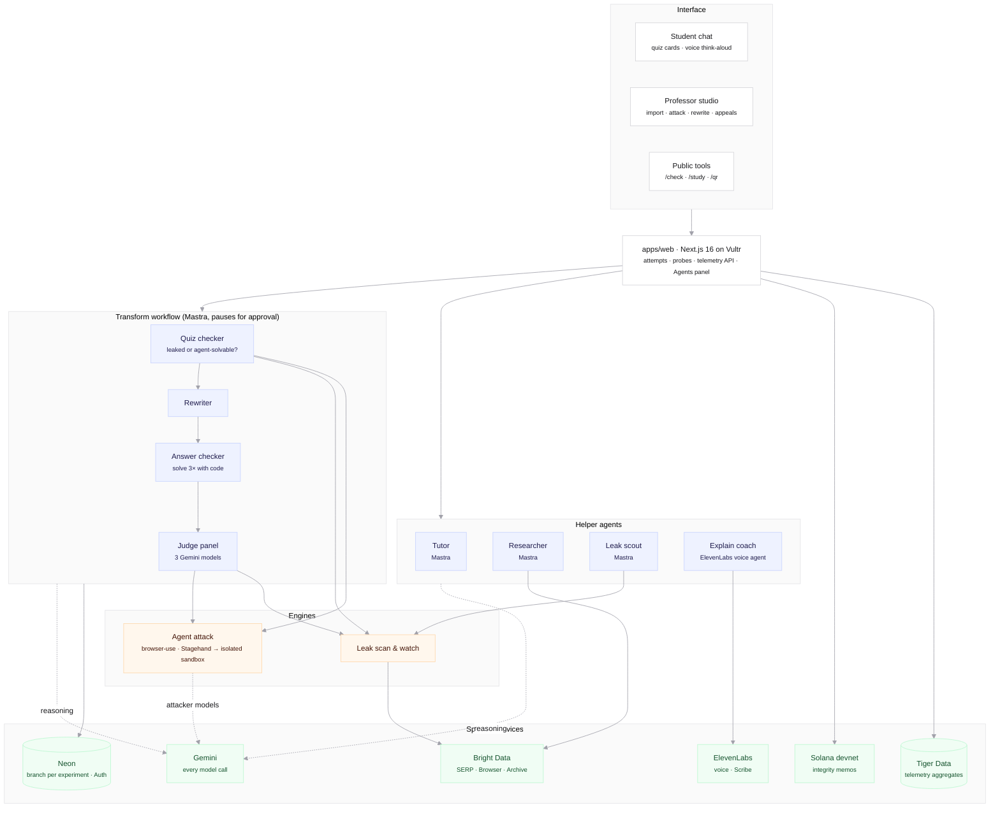
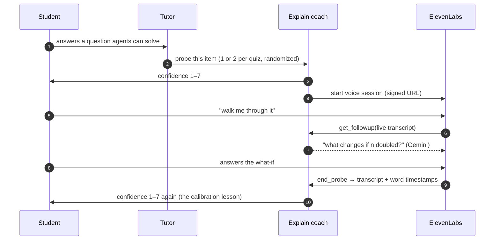

<div align="center">

# Unprompted

**You can't write a question an agent can't answer. So check understanding where an agent can't stand in.**

A learning app for the age of AI agents. Unprompted attacks a quiz with the same browser agents students use, finds which questions are already on homework sites, rewrites those so a copied answer key stops working (same answer, same skill), and asks students to talk through their reasoning by voice at the moments an agent would have answered for them.

`Next.js 16` · `Mastra` · `Gemini` · `ElevenLabs` · `Neon` · `Tiger Data` · `Bright Data` · `Solana` · `Vultr` · `browser-use` · `Stagehand`

</div>

---

## Live demo

**https://144-202-119-181.sslip.io** (Vultr). Public, no sign-in: `/check` (live leak checker), `/study` (Textbook Leak Index and open dataset) and `/qr` (printable QR code to `/check`). Everything else is behind a team password, then the one-click demo student or professor sign-in.

## Why

Agents can now log into a student's LMS and finish quizzes on their own, and there is no technical fix on the LMS side. Detectors that judge how text *looks* misfire on non-native writers. And rewriting questions does not stop agents either: we raced 10 rewrites of one question across four strategies (new numbers, real-world setting, find-the-error, table lookup) and Gemini browser agents solved every one we could measure (6/6 and 8/8 valid runs). Every attempt is kept as a Neon branch you can inspect. So Unprompted stops trying to out-write the agent:

| Instead of | Unprompted |
|---|---|
| Guessing whether text is AI-written | **Proves** which questions agents can solve, by running real agents against them |
| Banning tools, or rewriting until agents fail | **Rewrites** the questions that are already online so a copied answer key stops working, keeping only versions with the same answer and skill; the agent solve rate is measured and shown, never claimed away |
| Accusing students | **Asks** for a 30 to 60 second think-aloud with a "what if" follow-up, and shows the gap between *answered* and *understood* |

Every flag is evidence for a conversation, never a verdict.

## Architecture



Tutor, Researcher and Leak scout are Mastra agents. Explain coach is the ElevenLabs voice agent. Quiz checker, Rewriter, Answer checker and Judge panel are the steps of the transform workflow, shown as agents in the studio's Agents panel.

### How a leaked question gets rewritten

```mermaid
sequenceDiagram
    autonumber
    participant Prof as Professor
    participant QC as Quiz checker
    participant Ag as Browser agents
    participant WF as Transform workflow
    participant BD as Bright Data
    participant Neon as Neon
    Prof->>QC: import or attack a quiz
    QC->>BD: is each question already on homework sites?
    QC->>Ag: run agents × Gemini models × repeats (isolated)
    Ag-->>QC: per-question solve rate (server-graded)
    QC->>WF: items that are leaked, or solved ≥ 60% of the time
    loop up to N candidates per item
        WF->>Neon: create branch exp/item/n
        WF->>WF: generate variant · solve 3× with code, all must match the key
        WF->>WF: 3 Gemini judges (unanimous): same skill? unambiguous?
        WF->>BD: exact-phrase search: is the rewrite already online?
        WF->>Ag: re-attack the variant
        Ag-->>WF: new solve rate
        WF->>Neon: keep if same answer, same skill and not online; record the solve rate either way
    end
    WF-->>Prof: suspended for approval
    Prof->>WF: approve → resume → merge survivors into main
```

By default the re-attack solve rate is reported, not used to reject. A stricter mode (`requireAgentResistance`) also requires a solve rate ≤ 0.3 and at least 0.4 below the original.

### How a student is probed



## Professor workflows

| Workflow | What happens |
|---|---|
| Import from Canvas (QTI) | The quiz is imported, every question is leak-checked with Bright Data, and each leaked one gets a one-click "Write a new version" |
| Scan my course website | For a public course site you own: posted problems are extracted, leak-checked, and can be rewritten |
| Attack my quiz | Sandboxed browser agents take the quiz; solve rates with confidence intervals |
| Students | Class roster with explanation scores, explanation mode (voice or typed) and typing evidence; approve grades |
| Appeals ("Show what they saw") | In the studio: Neon time travel restores the exact quiz version a student received |
| Export to Canvas | The delivered quiz, approved rewrites included, as a Canvas-importable QTI zip |

## Public tools (no sign-in)

| Page | What it does |
|---|---|
| `/check` | **Is your question already online?** Paste any quiz question; Bright Data searches homework sites live and returns which sites have it, with public links. Rate-limited, at most 4 searches per check, and the pasted text is never stored (only a hash for the cache). |
| `/study` | **The State of Leaked Homework.** The Textbook Leak Index (36–48% of 500 random exercises found) with charts by subject and site, the method and limits, and the open dataset (CSV/JSON, CC BY 4.0: links and match scores only, no copied text). `GET /study/verify` re-checks a dataset file against its Solana memo. |
| `/qr` | A printable QR code pointing at `/check`. |

## Sponsors: how each one is used

| Sponsor | What it does in Unprompted |
|---|---|
| **Gemini** | Every model call: browser-agent attackers, variant generation, the 3-judge panel, follow-up questions. Direct key, or GMI as a quota-free route to the same Gemini models |
| **Mastra** | The Tutor, Researcher and Leak scout agents with real tools, and the transform workflow (Quiz checker, Rewriter, Answer checker, Judge panel) with human-in-the-loop `suspend()` / `resume()` for professor approval |
| **Neon** | App data, **one copy-on-write branch per question experiment** (only survivors merge), time travel for appeals, and Neon Auth sign-in |
| **Tiger Data** | Telemetry hypertables, continuous aggregates, `state_agg` / `heartbeat_agg` features that separate agents from humans by behavior |
| **Bright Data** | Leak scan (SERP), exact-phrase check of every rewrite, evidence screenshots (Browser API), daily leak watch (Web Archive), cited sources for the Researcher |
| **ElevenLabs** | The voice think-aloud agent with client tools, and Scribe word timestamps for counterfactual latency |
| **Solana** | Public integrity notary on devnet: fingerprints of the quiz each student received, agent results and the open dataset |
| **Vultr** | Hosts the live demo (systemd + Caddy); the only deploy target |

## Results so far (real data, Nov 15 2026)

| Check | Result |
|---|---|
| Agents ace our quizzes | browser-use + Gemini, run in the isolation sandbox: **175/175** item answers correct across all six quizzes (95% CI 98–100%). Stats 25/25, stats inference 36/36, calculus 36/36, Python 30/30, biology 24/24, microeconomics 24/24. 14 runs that crashed before submitting are reported separately as infrastructure, never as agent failures |
| **Textbook Leak Index (Bright Data)** | Of **500 random end-of-chapter exercises from 10 open textbooks, 36% (95% CI 32–40) show up on homework sites with the question's ask visible, and 48% (CI 44–53) have an exact 8–12 word phrase quoted** on a homework page. Highest: American Government (70–82%), then Biology and Microeconomics; lowest: Calculus. An earlier 92-exercise pilot found 84% (77/92), but used hand-picked distinctive stems. Method, limits and the open dataset in [`docs/leak-study.md`](docs/leak-study.md) and `/study` |
| Rewriting doesn't stop agents | 10 rewrites of one stats question raced on Neon branches; every one we could measure was still solved (6/6 and 8/8) |
| Our own quiz is online | 2 of the 5 items on our stats quiz matched homework-site results, shown with evidence |
| Behavior beats bot flags | Automated sessions passed `webdriver` and BotD checks, but were caught by *clicks with no pointer movement* and *answers with no input events* |
| Voice probe | Tool loop verified against the live ElevenLabs agent in text mode |

## Repository

```
apps/
  web/            Next.js app: student chat, think-aloud, studio, professor pages, public tools, telemetry API
    lib/notary/   Solana devnet notary
  sandbox/        Minimal quiz site that agents attack in isolation
services/
  workflows/      Mastra agents + transform workflow, Neon branch store, Markdown and QTI ingest, leak watch
  agents/         `attack` CLI: browser-use (Python) and Stagehand (TS) runners, isolation/ sandbox
  leakscan/       Bright Data leak scan, evidence capture and the leak study
packages/
  shared/         Types shared by every workstream (Item, AgentRun, AgentEvent, …)
  probe-core/     Follow-up question generator shared by the chat and the agents
db/
  neon/           App schema
  tiger/          Hypertables, continuous aggregates, feature views
tests/e2e/        LLM-free Playwright smoke tests of the whole app
data/quizzes/     Six original quizzes (the only content sent to models)
data/open/        The open leak dataset and its Solana anchors
docs/             build-plan.md (full spec) · CONTRACTS.md (team rules) · DESIGN.md · leak-study.md
```

## Getting started

**Requirements:** Node 25+, pnpm 10, Python 3.12+ with [uv](https://docs.astral.sh/uv/), Chrome. Attack isolation uses macOS `sandbox-exec`.

```bash
pnpm install
cp .env.example .env.local                        # fill in the keys below; never commit this file
pnpm dev:web                                      # http://localhost:3100
pnpm --filter @unprompted/workflows mastra:dev    # http://localhost:4111 (agents and transform workflow)
pnpm dev:sandbox                                  # http://localhost:3101 (only for agent attacks)
```

<details>
<summary><b>Environment variables</b></summary>

| Variable | Used for | Where to get it |
|---|---|---|
| `GEMINI_API_KEY` | all model calls | Google AI Studio |
| `GMI_API_KEY`, `GMI_BASE_URL` | the same Gemini models without the free-tier cap | GMI Cloud console; `https://api.gmi-serving.com/v1` |
| `ELEVENLABS_API_KEY`, `ELEVENLABS_AGENT_ID` | voice think-aloud | ElevenLabs → Developers → API Keys |
| `BRIGHTDATA_API_TOKEN`, `BRIGHTDATA_SERP_ZONE`, `BRIGHTDATA_CUSTOMER_ID`, `BRIGHTDATA_BROWSER_ZONE`, `BRIGHTDATA_BROWSER_PASSWORD`, `BRIGHTDATA_BROWSER_WSS` | leak scan, rewrite check, evidence, Researcher | Bright Data → Settings → API keys; SERP and Browser API zones |
| `NEON_API_KEY`, `NEON_PROJECT_ID`, `DATABASE_URL` | app data, branch per experiment, appeals | Neon console (project-scoped key) |
| `NEON_AUTH_BASE_URL`, `NEON_AUTH_COOKIE_SECRET`, `DEMO_PROFESSOR_PASSWORD`, `DEMO_STUDENT_PASSWORD`, `PROFESSOR_EMAILS` | sign-in (only enforced when Neon Auth is configured) | Neon console → Auth |
| `TIGER_DATABASE_URL` | telemetry | `tiger service create` → `tiger db uri <id> --with-password` |
| `SANDBOX_RUNNER_TOKEN` | shared secret for the attack runner API | any random string |
| `PUBLIC_BASE_URL` | the link `/qr` encodes | your deployed URL |
| `SOLANA_DEVNET_SECRET`, `SOLANA_DEVNET_RPC`, `NOTARY_SALT` | integrity notary (devnet only) | `lib/notary/cli.ts keygen`; any random salt |
| `CANVAS_BASE_URL`, `CANVAS_TOKEN` | optional Canvas API import | a Canvas teacher account |

Quote values that contain `&` (database URLs).

</details>

<details>
<summary><b>Databases</b></summary>

```bash
psql "$DATABASE_URL"       -f db/neon/schema.sql
psql "$TIGER_DATABASE_URL" -f db/tiger/schema.sql
psql "$TIGER_DATABASE_URL" -f db/tiger/aggregates.sql
# no psql? uv run --with "psycopg[binary]" python db/tiger/scripts/sql.py <file>
```

</details>

<details>
<summary><b>Commands</b></summary>

| Task | Command |
|---|---|
| Attack a quiz (isolated) | `cd services/agents && isolation/run.sh ../../data/quizzes/sample-stats.md --models gmi:google/gemini-3.8-flash --repeats 3` (browser agents refuse to run outside isolation) |
| Import a quiz | `pnpm --filter @unprompted/workflows ingest data/quizzes/<id>.md --quiz-id <id>` |
| Import a Canvas QTI export | `pnpm --filter @unprompted/workflows qti import <export.zip>` (export: `qti export <quizId> <out.zip>`) |
| Rewrite leaked or agent-solvable items | `pnpm --filter @unprompted/workflows transform` (`LLM_CACHE=replay` spends nothing) |
| Leak scan | `pnpm --filter @unprompted/leakscan scan` |
| Daily leak watch | `pnpm --filter @unprompted/workflows leakwatch:daily` |
| Neon branch check | `pnpm --filter @unprompted/workflows killtest:neon` |
| Anchor the open dataset | from `apps/web`: `../../services/leakscan/node_modules/.bin/tsx --conditions=react-server --env-file=../../.env.local lib/notary/cli.ts publish` |

</details>

<details>
<summary><b>Tests</b></summary>

```bash
pnpm test:e2e                                   # whole app, no model calls (needs pnpm dev:web)
pnpm --filter @unprompted/web typecheck
pnpm --filter @unprompted/workflows test
pnpm --filter @unprompted/leakscan test
pnpm --filter @unprompted/sandbox test
cd services/agents && uv run pytest
```

</details>

## Integrity anchoring (Solana devnet)

Unprompted uses Solana devnet as a public notary, not a database. For each integrity record (the exact quiz version a student received, each published agent-attack summary, and the `/study` open dataset files) we compute a fingerprint and write only that hash as an SPL Memo: `unprompted:v1:<kind>:<hash>`. Public files use a plain SHA-256, so anyone can re-hash them and compare with the on-chain memo (`GET /study/verify` and the Re-verify buttons do exactly that). Records that contain answers, like quiz versions, use HMAC-SHA256 with a server-only `NOTARY_SALT`, so a public hash can't be brute-forced back to an answer key. No student data or text ever goes on-chain.

Devnet only: the notary refuses any RPC that isn't devnet, by URL and by genesis hash. Anchoring is asynchronous and never blocks a student; if devnet is unavailable the record says "not anchored yet" and is retried. Code: `apps/web/lib/notary` (CLI: `lib/notary/cli.ts keygen | airdrop | anchor | verify | publish`). The signing key lives only in the local `.env.local`.

## Principles

- **Measure understanding; never accuse.** Flags read "suggest a follow-up chat", never "cheater".
- **Measure, don't claim.** Every rewritten question carries its measured agent solve rate, good or bad.
- **Grade content, not delivery.** No fluency or accent judgments; multilingual probes.
- **Honest numbers.** Bad results are reported; infrastructure failures are never counted as agent failures.
- **Only our own content goes to models.** OpenStax text (CC BY-NC-SA, no generative-AI use) is used only as leak-scan search strings, with attribution.
- **Respect the web.** Public pages only; we store snippets, links and screenshots, never solutions, and we never solve or bypass CAPTCHAs.
- **Agents attack only our own sandboxes**, never real courses or accounts.

<sub>Built at SanD Hacks 2026. Full spec: [`docs/build-plan.md`](docs/build-plan.md) · Team rules: [`docs/CONTRACTS.md`](docs/CONTRACTS.md)</sub>
