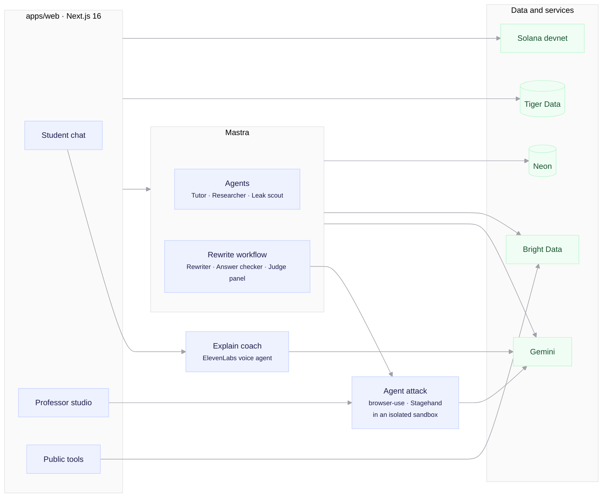
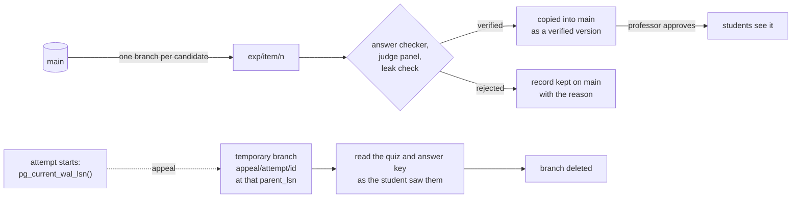
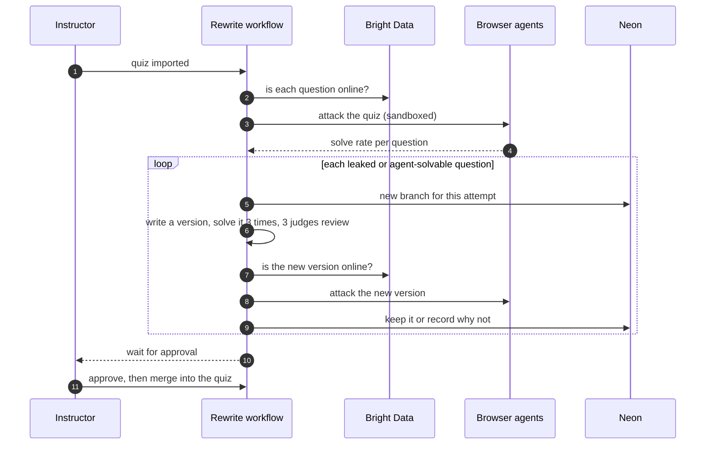
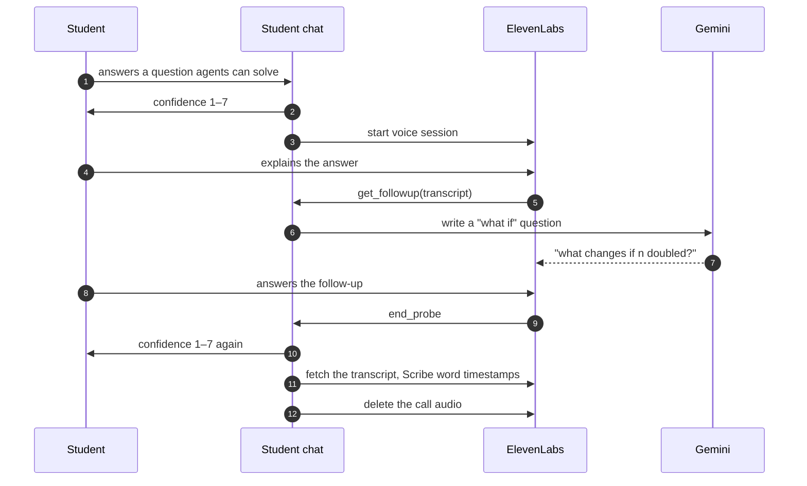

<div align="center">

# Unprompted

**Your quizzes stopped measuring learning. Fixing that shouldn't be another job.**

[Live demo](https://unprompted.courses) · [Check a question](https://unprompted.courses/check) · [Leak study](https://unprompted.courses/study)

</div>

---

## The problem

Professors are already stretched thin. Now the quizzes they spent years writing don't work:

- **Students hand the quiz to AI.** Browser agents can log into a course site and finish a quiz on their own. We ran them on six quizzes and they got **175 of 175** answers right.
- **The answers are already online.** **36–48%** of textbook exercises are posted on homework sites.
- **A good score no longer means a student learned anything.** Students who lean on AI skip the thinking the quiz was supposed to check.

The usual advice is to redesign every assessment, learn to spot AI writing, or move everything to in-class exams. That is hours of new work per course, AI detectors misfire on non-native writers, and it still doesn't hold: we rewrote one question 10 different ways and agents solved every version we could measure.

## What Unprompted does

**Nothing changes for the professor.** You keep your quiz, your course and your Canvas. The AI does the work, inside the bounds of the material you already teach.

| Step | You do | Unprompted does |
|---|---|---|
| 1. Import | Upload your Canvas quiz, or point at your course site | Reads every question |
| 2. Check | Nothing | Searches homework sites for each question, and has real AI agents take the quiz in a sandbox |
| 3. Rewrite | Nothing | Writes new versions of leaked questions: same skill, same answer, not findable online, so a copied answer key stops working |
| 4. Approve | One click per question | Nothing reaches students until you approve it |
| 5. Check understanding | Nothing | On one or two questions, students explain their answer out loud and get one "what if" follow-up, so you see who *answered* and who *understood* |
| 6. Export | Download | The finished quiz goes back to Canvas |

No new teaching strategy, no AI detector, no accusations. Every flag is a reason for a conversation, never a verdict.

## What we found

| Finding | Result |
|---|---|
| Agents solve our quizzes | **175 of 175** answers correct across six quizzes (95% CI 98–100%) |
| Textbook questions are already online | **36–48%** of 500 random exercises from 10 open textbooks |
| Rewriting doesn't stop agents | **Every** measured rewrite was still solved (6/6 and 8/8) |

Agent runs were sandboxed and server-graded. Runs that crashed are reported separately, never counted as agent failures. Method, limits and the open dataset: [`docs/leak-study.md`](docs/leak-study.md).

<details>
<summary><b>Full results</b></summary>

| Check | Result |
|---|---|
| Agents by quiz | Stats 25/25, stats inference 36/36, calculus 36/36, Python 30/30, biology 24/24, microeconomics 24/24 (browser-use + Gemini; 14 crashed runs excluded) |
| Leak index | 36% (CI 32–40) show the question itself on a homework site; 48% (CI 44–53) have an exact 8–12 word phrase quoted. Highest: American Government (70–82%), then Biology and Microeconomics. Lowest: Calculus |
| Leak pilot | 84% (77/92), but on hand-picked distinctive questions, so the index above is the honest number |
| Our own quiz | 2 of the 5 stats items matched homework-site results |
| Bot detection | Agent sessions passed `webdriver` and BotD checks, but were caught by clicks with no pointer movement and answers with no input events |

All data from Nov 15, 2026.

</details>

## Try it

| Page | Who | What it does |
|---|---|---|
| [`/check`](https://unprompted.courses/check) | Anyone | Paste a quiz question and see which homework sites already have it |
| [`/study`](https://unprompted.courses/study) | Anyone | The leak study, with charts and the open dataset (CC BY 4.0) |
| [`/qr`](https://unprompted.courses/qr) | Anyone | Printable QR code to `/check` |
| Student app | Demo sign-in | Take a quiz in a chat, with voice think-aloud |
| Professor studio | Demo sign-in | Import, attack, rewrite, approve and export quizzes |

Everything except the public pages is behind sign-in (Neon Auth, with demo accounts).

## How it works

### What makes a rewrite safe to use

A rewrite is kept only if:
- an independent solver gets the same answer 3 times out of 3,
- 3 Gemini judges agree it tests the same skill and is unambiguous, and
- an exact-phrase search finds it nowhere online.

Its agent solve rate is measured and shown either way.

### What students see

The quiz runs as a chat. On one or two questions, picked partly at random and weighted toward ones agents can solve or that are leaked, the student:

1. rates their confidence (1–7),
2. explains their answer out loud,
3. answers one "what if" follow-up, and
4. rates their confidence again.

Instructors see the explanation and a score of its content. Fluency and accent are never graded.

### Safeguards a professor can see

| Safeguard | What happens | Where |
|---|---|---|
| Confirm learning objective | A Canvas import can only guess what a question tests (its title or a stem excerpt), so those objectives are marked inferred. Before a rewrite, the professor confirms or edits the objective. The rewriter and the judges keep the confirmed text fixed, and the workflow refuses to rewrite a question whose objective is still a guess. | Studio, "Write a new version of Q…" on the leak scan card |
| Recording retention | Once the transcript and word timestamps are saved, the ElevenLabs call (audio and their copy of the transcript) is deleted and the time is recorded. Calls that were not final yet are retried when a professor opens the student page. Transcripts stay until the professor deletes them, which is also recorded. | Student consent step; `/professor/students/<pseudonym>` ("Audio deleted …", "Delete transcript", Data retention note) |
| Follow-up by &lt;model&gt; | Each think-aloud follow-up shows which path wrote it: the Gemini model that read this student's explanation, or the generic template when Gemini was unavailable. | `/professor/students/<pseudonym>` |

## Architecture



### Sponsors: exactly how each one is used

Every claim below points at the code that does it. The overview comes first, then each sponsor in detail.

| Sponsor | What it does | Where to see it |
|---|---|---|
| Gemini + Mastra | [8-agent team, Mastra + Gemini](#gemini--mastra-an-8-agent-team): Mastra orchestrates the agents and the rewrite workflow, and every agent reasons with Gemini | Student chat, the studio's Agents panel, `/professor/students/<pseudonym>` |
| Neon | App data, a branch per rewrite candidate, time travel for appeals, sign-in | Studio branch tree and race cards, "Show what a student saw", `/signin` |
| Bright Data | Finds questions already online, checks rewrites, captures evidence, watches homework sites | [`/check`](https://unprompted.courses/check), [`/study`](https://unprompted.courses/study), the leak radar |
| ElevenLabs | The voice think-aloud with one "what if" follow-up, timed with Scribe | Student chat "Talk it through", `/professor/students/<pseudonym>` |
| Tiger Data | Interaction telemetry turned into behavior signals, as evidence and never a verdict | `/professor` "Session patterns" |
| Solana | A public notary on devnet for quiz versions, agent results and the open dataset | [`/study`](https://unprompted.courses/study), `GET /study/verify` |
| Vultr + domain (Porkbun) | Hosting at unprompted.courses | [unprompted.courses](https://unprompted.courses) |

#### Gemini + Mastra: an 8-agent team

Gemini powers the browser benchmark, rewrite generation, question judges, and the what-if prompts. Mastra coordinates the transform stages, persists workflow state, and pauses verified candidates for instructor approval. The agent panel streams progress and check results into the studio.

Eight agents do the work. Three are Mastra Agents with their own tools, four are agents in a Mastra workflow (the rewrite workflow's steps, each shown as an agent in the studio's Agents panel), and one is the ElevenLabs voice agent. Every one of them reasons with Gemini.

| Agent | Built with | Gemini model | What it does | Where to see it |
|---|---|---|---|---|
| Tutor | Mastra Agent | `gemini-3.6-flash`, falling back to `gemini-3.5-flash-lite` | Starts quizzes, checks answers, explains results and serves today's practice through its tools | Student chat |
| Researcher | Mastra Agent | `gemini-3.6-flash`, falling back to `gemini-3.5-flash-lite` | Finds and reads sources through the Bright Data MCP server | Student chat, when you ask for sources |
| Leak scout | Mastra Agent | `gemini-3.6-flash`, falling back to `gemini-3.5-flash-lite` | Scans a quiz for questions already online and reports the evidence | Studio: "Is anything from my quiz online?" |
| Quiz checker | Agent in a Mastra workflow | `gemini-3.8-flash` (browser-use and Stagehand browser agents) | Takes the quiz like a student in a sandbox, then retakes the new versions | Studio: "Attack my quiz" and the Agents panel |
| Rewriter | Agent in a Mastra workflow | `gemini-3.6-flash` | Writes new versions of risky questions: same skill, same answer | Studio Agents panel and variant cards |
| Answer checker | Agent in a Mastra workflow | `gemini-3.6-flash` with the code execution tool | Solves each version 3 times with code; it must reproduce the answer key every time | Studio Agents panel ("key reproduced 3/3") |
| Judge panel | Agent in a Mastra workflow | `gemini-3.8-flash`, `gemini-3.6-flash` and `gemini-3.1-pro-preview`, voting | Checks that each version tests the same skill and is unambiguous | Studio Agents panel and variant cards ("n/3 agree") |
| Explain coach | ElevenLabs agent | `gemini-3.5-flash-lite` writes its follow-up | Listens to the student's explanation, then asks one "what if" follow-up written by Gemini from what they said | Student chat: "Talk it through". `/professor/students/<pseudonym>`: "Follow-up by &lt;model&gt;" |

The workflow pauses with `suspend()` until the professor approves or rejects each version, then continues with `resume()`. Its run state is stored in Mastra's `PostgresStore` on Neon, so a paused run survives a restart.

#### Gemini: every model call in the product

| | |
|---|---|
| What it does | Writes the rewrites, checks their answers, judges them, scores think-alouds, writes the "what if" follow-up, powers the helper agents and drives the attacking browser agents. |
| Models and features | Rewriter: `gemini-3.6-flash` (`GEN_MODEL`). Answer checker: `gemini-3.6-flash` with the **code execution** tool, solving each rewrite 3 times. Judge panel: `gemini-3.8-flash`, `gemini-3.6-flash` and `gemini-3.1-pro-preview` (`PANEL_MODELS`), with structured JSON output. Think-aloud grading council: the same three models. Mastra agents: `gemini-3.6-flash`, falling back to `gemini-3.5-flash-lite`. Follow-up question: `gemini-3.5-flash-lite`, then `gemini-3.1-flash-lite`, then `gemini-flash-latest`. Attack agents: `gemini-3.8-flash` (CLI default `gemini-3.5-flash`). Course-site scan: `gemini-3.6-flash`. |
| See it | Studio: rewrite cards with "n/3 agree" judge votes. Student chat: tutor replies and the follow-up question. `/professor/students/<pseudonym>`: the score and "Follow-up by &lt;model&gt;". |
| Key files | [`services/workflows/src/context.ts`](services/workflows/src/context.ts), [`steps/adapters.ts`](services/workflows/src/steps/adapters.ts), [`steps/llm.ts`](services/workflows/src/steps/llm.ts), [`council/index.ts`](services/workflows/src/council/index.ts), [`agents/model.ts`](services/workflows/src/agents/model.ts), [`packages/probe-core/src/gemini.ts`](packages/probe-core/src/gemini.ts) |
| Team | Every agent in the [8-agent team](#gemini--mastra-an-8-agent-team) reasons with Gemini. |
| Routing | A shared policy ([`packages/shared/src/gemini-policy.ts`](packages/shared/src/gemini-policy.ts)) tracks each model separately. A 429, 503 or timeout on the direct key puts that model in a cooldown (60 s, or Google's retry delay, backing off up to 10 min), and its calls go to GMI until the cooldown ends. The direct key is also throttled per minute and by concurrency. |
| Limits | GMI (`GMI_BASE_URL`) is only an OpenAI-compatible route to the same `google/gemini-*` models, used when the free-tier key is out of quota. It is not a sponsor and no other model family is called. The judge panel is three models from one family, and it is labelled that way. |

#### Mastra: the helper agents and the rewrite workflow

| | |
|---|---|
| What it does | Orchestrates the [8-agent team](#gemini--mastra-an-8-agent-team): runs three tool-using agents and the rewrite workflow, whose four steps are the team's workflow agents, and pauses until the professor approves each version. |
| Features | Agents (`Agent`, `createTool`): **Tutor** (`startQuiz`, `checkAnswer`, `explainResult`, `todaysPractice`, `checkPracticeAnswer`), **Researcher** (Bright Data tools over `@mastra/mcp` `MCPClient`) and **Leak scout** (`scanQuizForLeaks`, `leakReport`). Input processors (`FlattenToolHistory`, `AnswerBeforeLimit`). Workflow `createWorkflow` with steps `select-targets` → `transform` → `professor-approval`, which calls **`suspend()`** and continues on **`resume`** with the professor's decisions. Run state in `@mastra/pg` `PostgresStore` (Neon, schema `mastra`), so a paused run survives a restart. Streaming run events to the studio. |
| See it | Student chat: free text goes to the Tutor, or to the Researcher when you ask for sources. Studio: "Is anything from my quiz online?" goes to the Leak scout. A rewrite run streams into the studio and waits on Approve or Reject in each variant card. |
| Key files | [`services/workflows/src/mastra/index.ts`](services/workflows/src/mastra/index.ts), [`agents/`](services/workflows/src/agents), [`apps/web/app/studio/_lib/mastra.ts`](apps/web/app/studio/_lib/mastra.ts), [`apps/web/app/api/agents/[agent]/turn/route.ts`](apps/web/app/api/agents/[agent]/turn/route.ts), [`studio/api/variants/[id]/route.ts`](apps/web/app/studio/api/variants/[id]/route.ts) |
| Limits | The server runs `mastra dev` on the VM. "Answer checker", "Judge panel", "Rewriter" and "Quiz checker" are workflow steps shown as agents in the studio, not separate Mastra agents. |

#### Neon: app data, a branch per rewrite, time travel, sign-in

Every rewrite is an experiment on its own copy-on-write Neon branch; only verified versions are copied into `main`, only the ones the professor approves reach students, and appeals time-travel to the exact database state a student saw.



| | |
|---|---|
| What it does | Holds all app data, gives every rewrite candidate its own database branch, rebuilds exactly what a student saw for an appeal, and handles sign-in. |
| In real data | The project has `main` plus 26 experiment branches across 10 questions (Neon API, Nov 15 2026), for example `exp/sample-stats-q1/14`. Every one was branched from `main` at a recorded `parent_lsn`. Appeal branches are deleted after each read, so none are left over. |
| Features | **Branching API** (`console.neon.tech/api/v2`, create, list and delete branches): one copy-on-write branch per candidate, named `exp/<item>/<n>`. Neon has no native merge, so a candidate's experiment row is upserted into `main` either way (rejected ones keep their reason), and only verified candidates also bring their new item; the branch itself is kept. **Time travel**: each attempt records `pg_current_wal_lsn()` when it starts, and an appeal creates a short-lived branch at that `parent_lsn`, reads the quiz and answer key there, compares them with today's, then deletes the branch. **Neon Auth** (`@neon/auth`, Managed Better Auth) for sign-in and roles. **Postgres** for all app data, plus Mastra's `PostgresStore` (schema `mastra`), so a workflow paused with `suspend()` for professor approval survives a restart and continues with `resume()`. **Serverless driver** (`@neondatabase/serverless`) for the workflow branch connections; the web app uses `pg`. |
| See it | Studio: the branch race card (`/studio/api/race`), the experiment tree (`/studio/api/tree`) and the "Show what a student saw" appeal (`/studio/api/appeal`). `/signin`. |
| Key files | [`services/workflows/src/db/neon-store.ts`](services/workflows/src/db/neon-store.ts), [`db/merge.ts`](services/workflows/src/db/merge.ts), [`apps/web/app/studio/_lib/timetravel.ts`](apps/web/app/studio/_lib/timetravel.ts), [`apps/web/lib/auth/server.ts`](apps/web/lib/auth/server.ts), [`db/neon/schema.sql`](db/neon/schema.sql), [`services/workflows/scripts/neon-killtest.ts`](services/workflows/scripts/neon-killtest.ts) |
| Limits | Without `NEON_API_KEY` and `NEON_PROJECT_ID`, the workflows fall back to in-memory PGlite branches and appeals are unavailable. Sign-in is enforced only when Neon Auth is configured. We publish no branch timing numbers: the Neon kill test prints its timings but doesn't save them. |

#### Bright Data: finding questions that are already online

| | |
|---|---|
| What it does | Searches the open web for each quiz question, checks that a rewrite is not already posted, captures evidence, and watches homework sites for new copies. |
| Products | **SERP API** (`api.brightdata.com/request` with a SERP zone): exact-phrase searches for `/check`, the leak scan, the rewrite leak check and the daily leak watch. **Browser API** (Playwright `connectOverCDP`): evidence screenshots of public pages, with CAPTCHA solving off and challenge pages skipped. **Web Archive API** (`/webarchive/search`): a last-24-hour watch of homework-site URLs. **MCP server** (`mcp.brightdata.com`): the Researcher agent's search and page-reading tools. |
| See it | [`/check`](https://unprompted.courses/check) and [`/study`](https://unprompted.courses/study). Studio: the leak radar after an import ("web search" or "web archive" per hit). `/professor`: the leak radar. |
| Key files | [`services/leakscan/src/brightdata.ts`](services/leakscan/src/brightdata.ts), [`archive.ts`](services/leakscan/src/archive.ts), [`scan.ts`](services/leakscan/src/scan.ts), [`apps/web/app/check/_lib/check.ts`](apps/web/app/check/_lib/check.ts), [`services/workflows/src/steps/leakcheck.ts`](services/workflows/src/steps/leakcheck.ts), [`leakwatch.ts`](services/workflows/src/leakwatch.ts), [`agents/researcher.ts`](services/workflows/src/agents/researcher.ts) |
| Limits | Web Unlocker is deliberately not used, and no CAPTCHA is solved or bypassed. The Archive API returns counts, not pages, so an archive hit is labelled a candidate until confirmed. Searches are capped: at most 2 per question (4 per `/check`), cached 24 hours (1 hour for `/check`). |

#### ElevenLabs: the voice think-aloud

| | |
|---|---|
| What it does | Lets a student explain an answer out loud to a voice agent that asks one "what if" follow-up. |
| Features | **Conversational AI** agent with platform auth: the server issues a short-lived signed URL, and the browser connects with `@elevenlabs/react` `useConversation`. **Client tools** `get_followup` (we write the follow-up from the live transcript) and `end_probe`. Dynamic variables `item_stem` and `student_answer`. **Conversations API** to fetch the final transcript, then `DELETE` it once saved. **Scribe** speech-to-text (`scribe_v2`, then `scribe_v1`) on the call audio, with word timestamps and diarization, to time how long the student takes to start answering the follow-up. |
| See it | Student chat: "Talk it through" on a think-aloud. `/professor/students/<pseudonym>`: the transcript, "started answering after n s" and "Audio deleted …". |
| Key files | [`apps/web/components/probe/use-voice-probe.ts`](apps/web/components/probe/use-voice-probe.ts), [`apps/web/app/(student)/_lib/elevenlabs.ts`](apps/web/app/(student)/_lib/elevenlabs.ts), [`api/probes/[id]/voice/route.ts`](apps/web/app/(student)/api/probes/[id]/voice/route.ts), [`api/probes/[id]/voice/finish/route.ts`](apps/web/app/(student)/api/probes/[id]/voice/finish/route.ts), [`apps/web/lib/retention.ts`](apps/web/lib/retention.ts) |
| Limits | When Scribe is unavailable, the timing falls back to the browser's voice activity detection. Typing is always available instead of voice. |

#### Tiger Data: behavior telemetry

| | |
|---|---|
| What it does | Stores every interaction event and turns it into per-session behavior signals that separate scripted agents from people, as evidence and never as a verdict. |
| Features | **Hypertables** `interaction_events`, `agent_run_events` and `probe_timing`. A **continuous aggregate** `ie_item_1m` (1-minute `time_bucket`, with a refresh policy) holding Toolkit aggregates: `stats_agg` (key timing), **`state_agg`** (focus state) and **`heartbeat_agg`** (human input liveness), rolled up per attempt with `rollup()`. Views on top: `click_without_move`, `answer_input_gap`, `session_flags`, `attempt_features`, `attempt_dead_ranges` and `probe_latency`. |
| See it | `/professor`: the "Session patterns" panel. `/professor/students/<pseudonym>`: typing notes on typed think-alouds. |
| Key files | [`db/tiger/schema.sql`](db/tiger/schema.sql), [`db/tiger/aggregates.sql`](db/tiger/aggregates.sql), [`apps/web/lib/telemetry/server.ts`](apps/web/lib/telemetry/server.ts), [`apps/web/app/professor/_data.ts`](apps/web/app/professor/_data.ts) |
| Limits | The only human baseline is the instructor's own practice sessions, so there are no accuracy claims. Without `TIGER_DATABASE_URL`, events go to local JSON files. |

#### Solana: a public notary on devnet

| | |
|---|---|
| What it does | Puts a fingerprint of each delivered quiz version, the agent results and the open dataset on a public chain, so anyone can check they weren't changed later. |
| Features | **SPL Memo program** on **devnet** via `@solana/web3.js`: memo `unprompted:v1:<kind>:<hash>`. SHA-256 for public files, HMAC-SHA256 with a server-only salt for records that contain answer keys. A notary CLI (`keygen`, `airdrop`, `anchor`, `verify`, `publish`) and re-verification by re-hashing. |
| See it | [`/study`](https://unprompted.courses/study) (anchor status) and `GET /study/verify?file=<published file>`. `/professor` (attack summary anchor). |
| Key files | [`apps/web/lib/notary/index.ts`](apps/web/lib/notary/index.ts), [`registry.ts`](apps/web/lib/notary/registry.ts), [`cli.ts`](apps/web/lib/notary/cli.ts), [`data/open/anchors.json`](data/open/anchors.json), [`apps/web/app/(student)/api/attempts/route.ts`](apps/web/app/(student)/api/attempts/route.ts) |
| Limits | Devnet only: the notary refuses any other cluster by URL and by genesis hash. No student data goes on-chain. The three published files are currently `not_anchored` because the devnet wallet has no SOL to pay fees, so `/study/verify` reports them as not anchored until it is funded. |

#### Vultr + domain: hosting at unprompted.courses

| | |
|---|---|
| What it does | Serves the live app at [unprompted.courses](https://unprompted.courses). |
| Setup | Domain `unprompted.courses` registered at **Porkbun**. DNS `A @` and `A www` point to one **Vultr** Ubuntu VM (firewall: 22, 80, 443 only). **Caddy** reverse proxy with automatic HTTPS; `www` redirects to the apex. **systemd** services for the Next.js production server and the Mastra server (port 4111). Secrets live in an env file on the VM only. |
| See it | [unprompted.courses](https://unprompted.courses) (also `144-202-119-181.sslip.io`). |
| Key files | [`infra/README.md`](infra/README.md) |
| Limits | One VM, no autoscaling. The attack sandbox is not deployed there; agent runs happen locally in isolation. |

<details>
<summary><b>Rewrite workflow in detail</b></summary>



Selection: a question is rewritten if it is leaked or agents solve it at least 60% of the time. The agent solve rate of a rewrite is recorded, not used to reject it, unless `requireAgentResistance` is on (then it must be ≤ 0.3 and at least 0.4 below the original).

</details>

<details>
<summary><b>Voice probe in detail</b></summary>



</details>

<details>
<summary><b>Integrity anchoring (Solana devnet)</b></summary>

Solana devnet is used as a public notary, not a database. For each delivered quiz version, published agent result and dataset file, only a hash goes on-chain as an SPL Memo (`unprompted:v1:<kind>:<hash>`). Public files use SHA-256, so anyone can re-hash and compare (`GET /study/verify`). Records that contain answers use HMAC-SHA256 with a server-only salt, so the hash can't be reversed into an answer key. No student data ever goes on-chain. The notary refuses any network other than devnet. Code: `apps/web/lib/notary`.

</details>

## Principles

- **Never accuse.** Flags say "suggest a follow-up chat", never "cheater".
- **Measure, don't claim.** Every rewrite shows its measured agent solve rate, good or bad.
- **Grade content, not delivery.** No fluency or accent judgments.
- **Honest numbers.** Bad results are reported; crashes never count as agent failures.
- **Only our own content goes to models.** OpenStax text is used only as search strings, with attribution.
- **Respect the web.** Public pages only; no stored solutions; no CAPTCHA solving or bypassing.
- **Agents attack only our own sandboxes**, never real courses or accounts.

## Run it locally

**Requirements:** Node 25+, pnpm 10, Python 3.12+ with [uv](https://docs.astral.sh/uv/), Chrome, macOS (agent isolation uses `sandbox-exec`).

```bash
pnpm install
cp .env.example .env.local                        # fill in keys; never commit this file
pnpm dev:web                                      # app          http://localhost:3100
pnpm --filter @unprompted/workflows mastra:dev    # Mastra       http://localhost:4111
pnpm dev:sandbox                                  # attack site  http://localhost:3101
```

<details>
<summary><b>Environment variables</b></summary>

| Variables | Used for |
|---|---|
| `GEMINI_API_KEY`, `GMI_API_KEY`, `GMI_BASE_URL` | Model calls (GMI is a quota-free route to the same Gemini models) |
| `ELEVENLABS_API_KEY`, `ELEVENLABS_AGENT_ID` | Voice think-aloud |
| `BRIGHTDATA_API_TOKEN`, `BRIGHTDATA_SERP_ZONE`, `BRIGHTDATA_CUSTOMER_ID`, `BRIGHTDATA_BROWSER_ZONE`, `BRIGHTDATA_BROWSER_PASSWORD`, `BRIGHTDATA_BROWSER_WSS` | Leak search and evidence |
| `NEON_API_KEY`, `NEON_PROJECT_ID`, `DATABASE_URL` | App data, branches, appeals |
| `NEON_AUTH_BASE_URL`, `NEON_AUTH_COOKIE_SECRET`, `DEMO_PROFESSOR_PASSWORD`, `DEMO_STUDENT_PASSWORD`, `PROFESSOR_EMAILS` | Sign-in (enforced only when Neon Auth is set) |
| `TIGER_DATABASE_URL` | Telemetry |
| `SANDBOX_RUNNER_TOKEN` | Shared secret for the attack runner |
| `PUBLIC_BASE_URL` | The link `/qr` encodes |
| `SOLANA_DEVNET_SECRET`, `SOLANA_DEVNET_RPC`, `NOTARY_SALT` | Devnet notary |
| `CANVAS_BASE_URL`, `CANVAS_TOKEN` | Optional Canvas API import |

Quote values that contain `&` (database URLs).

</details>

<details>
<summary><b>Databases</b></summary>

```bash
psql "$DATABASE_URL"       -f db/neon/schema.sql
psql "$TIGER_DATABASE_URL" -f db/tiger/schema.sql
psql "$TIGER_DATABASE_URL" -f db/tiger/aggregates.sql
# no psql? uv run --with "psycopg[binary]" python db/tiger/scripts/sql.py <file>
```

</details>

<details>
<summary><b>Commands</b></summary>

| Task | Command |
|---|---|
| Attack a quiz | `cd services/agents && isolation/run.sh ../../data/quizzes/sample-stats.md --models gmi:google/gemini-3.8-flash --repeats 3` |
| Import Markdown | `pnpm --filter @unprompted/workflows ingest data/quizzes/<id>.md --quiz-id <id>` |
| Import or export QTI | `pnpm --filter @unprompted/workflows qti import <export.zip>` / `qti export <quizId> <out.zip>` |
| Rewrite questions | `pnpm --filter @unprompted/workflows transform` (`LLM_CACHE=replay` spends nothing) |
| Leak scan | `pnpm --filter @unprompted/leakscan scan` |
| Daily leak watch | `pnpm --filter @unprompted/workflows leakwatch:daily` |
| Anchor the dataset | in `apps/web`: `../../services/leakscan/node_modules/.bin/tsx --conditions=react-server --env-file=../../.env.local lib/notary/cli.ts publish` |

Browser agents refuse to run outside `isolation/run.sh`.

</details>

<details>
<summary><b>Tests</b></summary>

```bash
pnpm test:e2e                          # whole app, no model calls (needs pnpm dev:web)
pnpm --filter @unprompted/web typecheck
pnpm --filter @unprompted/workflows test
pnpm --filter @unprompted/leakscan test
pnpm --filter @unprompted/sandbox test
cd services/agents && uv run pytest
```

</details>

<details>
<summary><b>Repository layout</b></summary>

```
apps/web/            Next.js app: student chat, professor studio, public tools, notary
apps/sandbox/        Minimal quiz site that agents attack in isolation
services/workflows/  Mastra agents, rewrite workflow, imports, leak watch
services/agents/     attack CLI (browser-use, Stagehand) and its isolation sandbox
services/leakscan/   Bright Data leak scan and the leak study
packages/shared/     Shared types
packages/probe-core/ Follow-up question generator
db/                  Neon and Tiger schemas
tests/e2e/           Playwright smoke tests
data/quizzes/        Six original quizzes (the only content sent to models)
data/open/           Open leak dataset and its Solana anchors
docs/                Spec, team rules, design notes, leak study
```

</details>

<br>

<sub>Built at SanD Hacks 2026 · [Spec](docs/build-plan.md) · [Team rules](docs/CONTRACTS.md)</sub>
